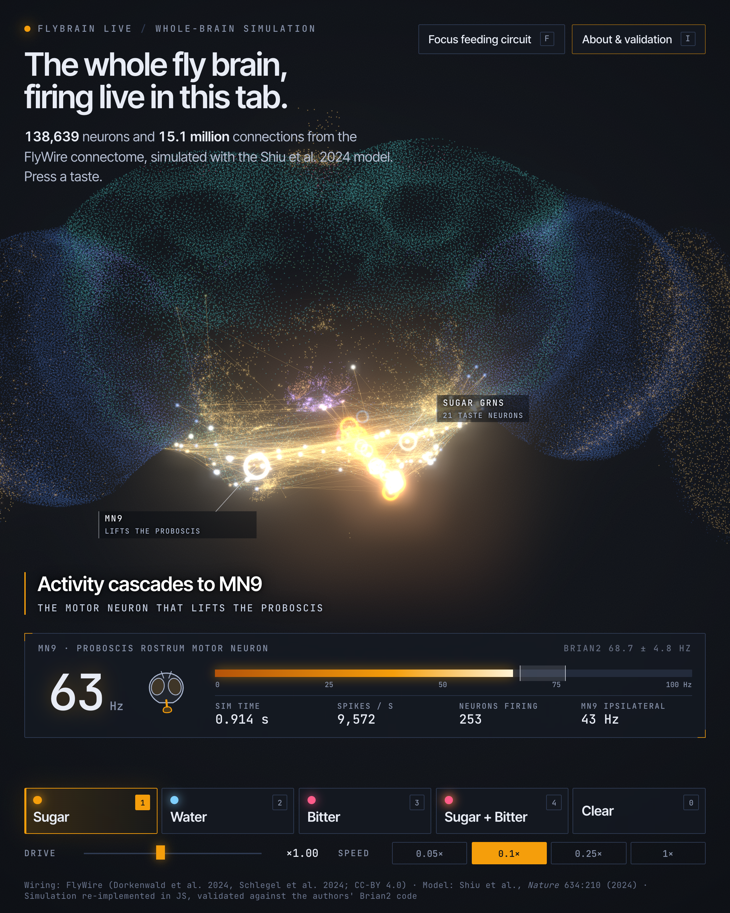

# flybrain-live

**Live demo: <https://flybrain.teshnizi.dev>** (the first load downloads the 30.7 MB graph; devices with 2 GB of RAM or less get the 17.1 MB lite graph) · MIT licence

**A whole fruit-fly brain, simulated live in a browser tab.** All 138,639 neurons of the adult *Drosophila* brain (FlyWire
public release 783) with their real wiring (15.1 million connections, 54.5 million synapses), driven by the leaky
integrate-and-fire model of Shiu et al. 2024 (*Nature* 634:210), drawn at each neuron's true 3D position, and **checked
against the authors' own Brian2 code**. Press *Sugar*: 21 taste neurons fire, activity cascades through the wiring, and
the motor neuron that extends the proboscis (MN9) starts firing, the paper's headline prediction. Add *Bitter* and MN9 goes silent.



Video (20 s, 1080x1350): [`media/flybrain-1080x1350.mp4`](media/flybrain-1080x1350.mp4). Phone layout (375 px): [`media/phone-375.png`](media/phone-375.png).

## Run it

```bash
cd site && python3 -m http.server 8000      # then open http://localhost:8000
```

Needs a browser with WebGL2 and `DecompressionStream` (Chrome/Edge 80+, Safari 16.4+, Firefox 113+). The page streams
30.7 MB (the connectome, gzip) plus 2.0 MB (positions and labels), decodes it in a worker
(about 316 ms in Node) and holds ~91 MB of typed arrays. `?graph=lite` loads the
17.1 MB thresholded graph (edges with at least 2 synapses; selected automatically on devices reporting 2 GB of RAM or less).
Other URL options: `?stim=sugar|water|bitter|sugar%2Bbitter`, `?speed=0.05|0.1|0.25|1`, `?pos=anchor` (backbone anchor points instead of cell bodies: a sparser, star-map look), `?lines=0`.

Controls: keys `1`-`4` stimuli, `0` clear, `Space` pause, `R` reset, `F` fly to the feeding circuit, `L` cascade lines, `I` about/validation.
Hover a neuron for its cell type, class and transmitter. Playback is slowed (default 0.1x real time) so the cascade is visible.

## What the numbers say

Everything below comes from `results/` (JSON, with the script that wrote it); nothing is typed by hand.
MN9 rates are means &plusmn; sd over 30 independent trials of 1 s.

### 1. The headline: sugar to MN9, against the authors' own outputs

**Sugar GRNs at 100 Hz** (30 trials of 1 s each; MN9 = the motor neuron contralateral to the stimulated neurons)

| source | MN9 contra, Hz | MN9 ipsi, Hz | trials with MN9 spikes | neurons that fired | spikes per trial |
|---|---|---|---|---|---|
| authors' shipped output files, FlyWire v630 | 67.0 &plusmn; 6.6 | 48.6 | 30/30 | 404 | 9,636 |
| Brian2 2.10, authors' model.py, v630 (this repo) | 69.6 &plusmn; 3.6 | 51.1 | 30/30 | 405 | 9,852 |
| **JS engine**, v630 | 66.7 &plusmn; 4.9 | 49.8 | 30/30 | 405 | 9,676 |
| Brian2 2.10, authors' model.py, **v783** (this repo) | 68.7 &plusmn; 4.8 | 50.7 | 30/30 | 403 | 9,706 |
| **JS engine**, **v783** (this page) | 67.1 &plusmn; 4.5 | 49.1 | 30/30 | 423 | 9,633 |

**Sugar GRNs at 200 Hz** (30 trials of 1 s each; MN9 = the motor neuron contralateral to the stimulated neurons)

| source | MN9 contra, Hz | MN9 ipsi, Hz | trials with MN9 spikes | neurons that fired | spikes per trial |
|---|---|---|---|---|---|
| authors' shipped output files, FlyWire v630 | 93.3 &plusmn; 3.2 | 61.8 | 30/30 | 448 | 17,052 |
| Brian2 2.10, authors' model.py, v630 (this repo) | 92.8 &plusmn; 5.5 | 62.3 | 30/30 | 450 | 16,980 |
| **JS engine**, v630 | 92.5 &plusmn; 3.7 | 62.4 | 30/30 | 457 | 16,992 |
| Brian2 2.10, authors' model.py, **v783** (this repo) | 93.3 &plusmn; 5.2 | 61.6 | 30/30 | 444 | 16,920 |
| **JS engine**, **v783** (this page) | 95.1 &plusmn; 5.5 | 63.0 | 30/30 | 445 | 16,919 |

The authors' files are what their `example.ipynb` produced on FlyWire v630 (`sugarR_100Hz.parquet`, and `sugarR.parquet`, whose
GRN firing rate shows it was run at 200 Hz). Per-neuron mean rates of our Brian2 runs correlate with theirs at r = 0.999 (100 Hz) and
1.000 (200 Hz); for the JS engine r = 1.000 and 1.000
(`reference/compare_authors_v630.py`, neurons with >= 0.5 Hz). MN9 contralateral differences vs the authors' files: JS 66.7 vs 67.0 Hz (z = -0.22) and
92.5 vs 93.3 Hz (z = -0.85).

### 2. Spike-for-spike: identical input events through Brian2 and the JS engine

The stochastic part is removed: the same pre-drawn Poisson events are injected into the full v783 network in Brian2
(`reference/replay_brian2.py`, the authors' unmodified `model.py`) and in the JS engine (`tools/replay_check.mjs`, also
`tests/replay.test.mjs`). 1 s of fly time, 138,639 neurons.

| condition | input events | Brian2 spikes | JS spikes | spike trains | snapping eps |
|---|---|---|---|---|---|
| sugar_10 | 198 | 248 | 248 | identical | 0 |
| sugar_10 | 198 | 248 | 248 | identical | 1e-07 |
| sugar_100 | 2,051 | 9,552 | 9,552 | identical | 0 |
| sugar_100 | 2,051 | 9,552 | 9,552 | identical | 1e-07 |
| sugar_100__bitter_200 | 6,322 | 10,642 | 10,642 | identical | 0 |
| sugar_100__bitter_200 | 6,322 | 10,642 | 10,642 | identical | 1e-07 |
| sugar_200 | 4,093 | 16,521 | 16,521 | identical | 0 |
| sugar_200 | 4,093 | 16,521 | 16,521 | identical | 1e-07 |
| water_200 | 3,510 | 7,365 | 7,365 | identical | 0 |
| water_200 | 3,510 | 7,365 | 7,365 | identical | 1e-07 |

All 44,328 spikes (neuron and 0.1 ms step) match in all 5 conditions, both with exact arithmetic (eps = 0) and with the
production setting. Small random networks give the same (`tests/oracle.test.mjs`: 4 fixtures, 17 to 8,117 spikes, state `g` bit-identical,
`v` within 2e-15 V; Brian2's compiled C rounds the `v` update differently from IEEE JS, up to ~150 ulp, which never changed a spike).

### 3. The paper's protocol, JS vs Brian2, 17 conditions x 30 trials (FlyWire v783)

Criteria fixed before looking (`tools/validate_engine.mjs`): MN9 contra and ipsi rate Welch |z| <= 3.5 (or |diff| <= 1 Hz when tiny);
total spikes per trial within 3 %; number of neurons that fired within 15 % (or 8); per-neuron mean-rate Pearson r >= 0.98.
`z2` = mean over neurons of (C_js - C_b2)^2 / (C_js + C_b2) on 30-trial spike counts (Poisson counting noise; equivalent engines give <= 1).

| condition (GRN Hz) | Brian2 MN9 | JS MN9 | z | spikes/trial Brian2 / JS | neurons fired B / JS | rate r | z2 | all criteria met |
|---|---|---|---|---|---|---|---|---|
| bitter_100 | 0.0 &plusmn; 0.0 | 0.0 &plusmn; 0.0 | +0.00 | 2,870 / 2,888 | 66 / 63 | 0.9993 | 0.81 | yes |
| bitter_200 | 0.0 &plusmn; 0.0 | 0.0 &plusmn; 0.0 | +0.00 | 6,459 / 6,480 | 92 / 94 | 0.9997 | 0.33 | yes |
| sugar_10 | 0.0 &plusmn; 0.0 | 0.0 &plusmn; 0.0 | +0.00 | 245 / 248 | 39 / 43 | 0.9771 | 0.76 | **no** |
| sugar_25 | 0.0 &plusmn; 0.2 | 0.0 &plusmn; 0.2 | +0.00 | 850 / 852 | 91 / 82 | 0.9981 | 0.48 | yes |
| sugar_50 | 18.1 &plusmn; 7.1 | 19.8 &plusmn; 5.9 | +1.03 | 3,044 / 3,108 | 375 / 387 | 0.9992 | 0.78 | yes |
| sugar_100 | 68.7 &plusmn; 4.8 | 67.1 &plusmn; 4.5 | -1.36 | 9,706 / 9,633 | 403 / 423 | 0.9995 | 0.51 | yes |
| sugar_100__bitter_100 | 4.6 &plusmn; 2.8 | 4.6 &plusmn; 2.6 | +0.00 | 9,175 / 9,155 | 397 / 397 | 0.9995 | 0.52 | yes |
| sugar_100__bitter_200 | 0.1 &plusmn; 0.2 | 0.1 &plusmn; 0.3 | +0.87 | 10,482 / 10,515 | 294 / 286 | 0.9997 | 0.71 | yes |
| sugar_100__bitter_50 | 36.8 &plusmn; 5.9 | 38.9 &plusmn; 5.0 | +1.52 | 9,232 / 9,426 | 408 / 414 | 0.9994 | 0.88 | yes |
| sugar_100__ir94e_100 | 16.5 &plusmn; 6.2 | 16.2 &plusmn; 4.4 | -0.24 | 8,474 / 8,510 | 407 / 403 | 0.9996 | 0.42 | yes |
| sugar_100__water_100 | 86.3 &plusmn; 4.5 | 87.9 &plusmn; 4.8 | +1.31 | 15,019 / 15,150 | 492 / 491 | 0.9996 | 0.40 | yes |
| sugar_150 | 84.3 &plusmn; 4.6 | 84.7 &plusmn; 4.4 | +0.29 | 13,649 / 13,639 | 424 / 433 | 0.9996 | 0.42 | yes |
| sugar_200 | 93.3 &plusmn; 5.2 | 95.1 &plusmn; 5.5 | +1.32 | 16,920 / 16,919 | 444 / 445 | 0.9997 | 0.39 | yes |
| water_100 | 0.0 &plusmn; 0.0 | 0.0 &plusmn; 0.0 | +0.00 | 3,370 / 3,372 | 97 / 98 | 0.9994 | 0.34 | yes |
| water_150 | 6.1 &plusmn; 2.9 | 6.4 &plusmn; 3.0 | +0.39 | 5,283 / 5,297 | 299 / 261 | 0.9998 | 0.41 | yes |
| water_200 | 30.3 &plusmn; 5.0 | 32.4 &plusmn; 5.4 | +1.51 | 7,562 / 7,628 | 357 / 392 | 0.9998 | 0.69 | yes |
| water_260 | 53.1 &plusmn; 5.0 | 51.2 &plusmn; 5.1 | -1.52 | 10,454 / 10,413 | 438 / 460 | 0.9998 | 0.61 | yes |

The "neurons fired" column is a noisy statistic (one rare responder moves it): six independent blocks of 30 JS trials give
396-412 for sugar_100 (mean 403; Brian2: 403) and
317-415 for water_200 (mean 368; Brian2: 357) (`tools/responder_spread.mjs`).

16 of 17 conditions meet every criterion. **sugar_10 does not**: its per-neuron correlation is r = 0.9771
(< 0.98) on almost no activity (245 vs 248 spikes per trial, ~40 neurons); the noise-aware z2 is 0.76, and
the deterministic replay of that condition is spike-identical, so we read it as sampling noise in a near-silent condition, not an engine difference. The JS engine
on the v630 graph versus Brian2 on v630: `results/validation_js_vs_brian2_630.json`.

### 4. The paper's claims, one by one (every row except the last is a claim in the text of Shiu et al.)

| claim | paper | this repo |
|---|---|---|
| MN9 activated in 100 % of simulations by sugar GRNs at 100 Hz | 100 % | Brian2 v783 30/30; JS v783 30/30; Brian2 v630 30/30 |
| neurons responding (> 0 Hz in 30 trials) at 10 Hz and 200 Hz sugar, v630 | 45 and 455 | Brian2 39 and 450; JS 43 and 457 (v783, Brian2: 39 and 444) |
| contralateral MN9 driven more strongly than ipsilateral | yes | yes in 10 of 11 conditions with MN9 activity (sugar 100 Hz: 68.7 vs 50.7 Hz); exceptions, both near the floor: sugar_100__bitter_100: contra 4.6, ipsi 10.7 Hz |
| bitter added to sugar suppresses MN9; strong bitter eliminates it | yes | sugar 100 Hz alone 68.7; + bitter 50 Hz 36.8; + 100 Hz 4.6; + 200 Hz 0.1 Hz; bitter alone 0 |
| Ir94e inhibits MN9 less completely than strong bitter | yes | sugar 100 + Ir94e 100 Hz: 16.5 Hz (bitter 100 Hz: 4.6) |
| sugar and water GRNs act synergistically | yes | sugar 100 + water 100 Hz: 86.3 Hz; sugar 100 alone 68.7, water 100 alone 0.0 |
| water GRNs drive MN9 (up to 260 Hz in the paper) | yes | water 150/200/260 Hz: 6.1 / 30.3 / 53.1 Hz |
| *our pick:* Water and Bitter demo inputs are 200 Hz | not in the paper | chosen from this dose-response |

Not claimed by us: absolute rates (the authors say they are not predictions), anything beyond the gustatory circuit.

### 5. Why snapping is safe

Neurons whose `|v - v_0|` and `|g|` fall below eps are set to exact rest and leave the active set. Same seeds, 4 conditions x 5 seeds x 1 s
(`tools/epsilon_study.mjs`), spike trains compared with eps = 0:

| eps | runs identical to exact | differing spikes | mean peak active set |
|---|---|---|---|
| 0 V | 20/20 | 0 / 230,516 | 11,452 |
| 1e-09 V | 20/20 | 0 / 230,516 | 10,949 |
| 1e-08 V | 20/20 | 0 / 230,516 | 10,826 |
| 1e-07 V | 20/20 | 0 / 230,516 | 10,693 |
| 1e-06 V | 20/20 | 0 / 230,516 | 10,364 |
| 1e-05 V | 9/20 | 18,960 / 230,516 | 9,482 |

The page uses 1e-7 V, a factor 10 below the first value that changes anything.

## Sizes and speed

| file | raw | gzip -9 | brotli -q 11 |
|---|---|---|---|
| full connectome, FBG1 (15,091,983 edges) | 42.4 MB | **30.7 MB** | 26.2 MB |
| lite connectome (edges with >= 2 synapses, 7,595,967 edges, 86 % of synapses) | 22.0 MB | 17.1 MB | 14.6 MB |
| per-neuron arrays (positions, class, transmitter, side, cell type) | 2.5 MB | 2.0 MB | |

The full graph is under the 45 MB budget, so it is the default. Format: CSR with delta-varint targets and varint synapse counts, sign stored once per presynaptic neuron (it is constant per neuron).

Engine speed, whole brain, Node/V8 on Apple M4 (10 cores), eps = 1e-7 V, 5 s per repeat after a 1 s warm-up,
**median of 3 (range)**, measured while the machine was shared with other jobs (load average 8 at start; numbers are pessimistic and noisy):

| stimulus (GRN Hz) | real-time factor | spikes per simulated second | neurons integrated (mean) |
|---|---|---|---|
| sugar_100 | 2.49x (2.38-2.51) | 9,828 | 7,656 |
| sugar_200 | 1.32x (0.94-1.72) | 17,144 | 11,112 |
| water_200 | 2.44x (1.96-2.60) | 7,533 | 8,108 |
| bitter_200 | 3.62x (3.54-3.68) | 6,450 | 5,410 |
| sugar_100__bitter_200 | 3.05x (3.04-3.06) | 10,480 | 6,170 |
| sugar_100__water_100 | 1.52x (1.17-1.57) | 15,058 | 12,206 |
| water_260 | 1.53x (1.23-1.82) | 10,268 | 8,802 |

Real-time factor = simulated seconds per wall second; the page's default playback is 0.1x.

Inside the real page (module worker + WebGL rendering on the main thread, headless Edge, playback requested at 4x so the engine is the bottleneck; `tools/bench_browser.mjs`),
load average 12 on 10 cores at the start (the machine was shared with other jobs):

| stimulus | achieved simulated seconds per wall second | engine's own readout (median / max) |
|---|---|---|
| sugar | 0.91x | 0.9x / 1.1x |
| water | 1.12x | 1.1x / 1.4x |
| sugar+bitter | 1.42x | 1.4x / 1.6x |

So under load the page sustained 0.4x to 1.4x real time (the low end is the single readout of the smoke test), well above the 0.1x playback it uses by default and the 0.25x design target; a quiet machine should do better.
`tools/smoke_page.mjs` / `results/page_smoke.json`: 55 fps in headless Edge during a cascade; sugar gave MN9 67 Hz after ~8 s at 1x playback
(engine readout "0.4× real time · playing 1×" at that moment), sugar + bitter gave 0 Hz, no console errors, the graph in the page had N = 138,639 neurons and E = 15,091,983 connections, no horizontal scroll at 375 px.

### The lite graph (optional)

Dropping every single-synapse edge keeps 86 % of synapses. Effect on MN9, JS engine on the lite graph vs the Brian2 reference on the full graph (30 trials each):

| condition | Brian2 full | JS lite | diff, Hz | total spikes |
|---|---|---|---|---|
| sugar_100 | 68.7 | 69.3 | +0.6 | -1.7 % |
| water_200 | 30.3 | 26.2 | -4.2 | -4.4 % |
| bitter_200 | 0.0 | 0.0 | +0.0 | -3.3 % |
| sugar_100__bitter_200 | 0.1 | 0.1 | +0.0 | -2.7 % |
| sugar_100__bitter_100 | 4.6 | 4.8 | +0.2 | +0.0 % |

The sugar and bitter results survive; water is about 13 % weaker. That is why the lite graph is an option, not the default.

## Media

`media/flybrain-1080x1350.mp4` (20 s, H.264, yuv420p, no audio) and `media/hero.png` (2160x2700) come from `tools/capture.mjs`: the page's `?capture=1` mode steps the engine a fixed 33 steps (3.3 ms of fly time)
per 1/30 s frame (0.099x playback), follows the storyboard in `tools/capture_timeline.mjs` (idle brain, Sugar at 2.5 s, Sugar + Bitter at 11.5 s), renders each frame in headless Edge and encodes with ffmpeg.
Nothing depends on the wall clock, so the video is reproducible. The ~1080x1080 cut was not made: the layout is portrait-first.

## How it works

* **Engine** (`site/engine/lif.js`, no dependencies, runs in a Web Worker and under Node): the exact update Brian2 executes for the authors' model
  (0.1 ms steps, exact integration of the linear subthreshold system, 18-step delay line of spike lists, 22-step refractory period, input to refractory neurons is dropped,
  resets applied after delivery); only neurons off rest are integrated (resting is an exact fixed point of the update). Details and parameters: [`docs/MODEL.md`](docs/MODEL.md).
* **Page** (`site/`): three.js points at the neurons' positions (FlyWire voxels are 4x4x40 nm; the frame is a view onto the fly's face), a per-point "last spike time" so only spiking neurons
  are written each frame, additive blending + bloom, cascade lines from the last excitatory sender before each spike, a raster of the 100 most active neurons sorted by latency.
  Colour: amber = excitatory spike, ice-blue = inhibitory spike.
* **Tests** (`npm test`, 41 of 41 pass): Brian2-oracle fixtures, constants, PRNG, graph codec, source tracking, the full-network replays, and `tests/stats.test.mjs` (4 gustatory conditions x 30 trials against the Brian2 JSON with a stated criterion, plus a negative control that must reject a 20 % weaker stimulus).

## Honest limits

* A model of the paper's model: leaky integrate-and-fire, one free weight (0.275 mV per synapse), no gap junctions, neuromodulation, plasticity, dendrites or spontaneous activity. The authors state that absolute rates are not predictions.
* Signs come from the paper's connectivity file (predicted transmitter); they agree with the v783 top-transmitter annotation for 95.6 % of neurons (`results/nt_sign_check.json`).
* The notebooks use FlyWire v630 IDs; three IDs (a sugar GRN, a bitter GRN, the ipsilateral MN9) changed in v783 and were re-matched by synaptic-partner similarity (cosine 1.0, 1.0, 0.99998; `results/id_mapping_630_to_783.json`).
  Seven of the paper's 18 "water" neurons are annotated sugar GRNs in v783; the paper's lists are used as published.
* Sugar 100 Hz is the paper's calibration point. Water 200 Hz and Bitter 200 Hz are our picks from the dose-response, not the paper's.
* Brian2 here is 2.10.1 (the paper used 2.5.1); the validation is against the authors' model code, not their 2.5.1 binaries. The sugar-10 Hz condition misses one correlation criterion (see above).
* "Cascade lines" show the last excitatory sender before each spike (within 15 ms): plausible cause, not proof. Positions are cell bodies for 118,086 neurons and backbone anchor points for the 20,539 (mostly sensory) whose cell bodies lie outside the volume; 14 neurons without an annotation are not drawn (`results/position_stats.json`).
* The paper's figure grids (e.g. sugar x bitter, sugar x water, silencing screens) were not compared one by one: the authors' raw output archive (several GB) was not downloaded. We compared against the shipped example outputs, the text claims, and our own Brian2 runs of the same model.
* Playback is slowed down for viewing; the speed tables are what the engine sustains on one laptop (a single worker thread) while the machine was busy with other jobs, so they are lower bounds for a quiet laptop.

## Reproduce

```bash
tools/fetch_data.sh                                   # inputs into data/raw/ (gitignored): model repo, connectivity, annotations
uv venv --python 3.12 .venv && uv pip install -r requirements.txt && npm install
python tools/map_v630_ids.py                          # results/id_mapping_630_to_783.json
python reference/run_brian2.py --graph 783 --cond sugar_100 --trials 30     # ~3 min per condition; all conditions in reference/conditions.py
python reference/replay_brian2.py --graph 783 --cond sugar_100 --seed 123   # deterministic replay inputs/outputs
python tools/prepare_data.py                          # site/data/* and sizes (~6 min)
npm test                                              # engine tests incl. full-network replays and the statistical test (~2.3 min)
node tools/validate_engine.mjs --graph 783 --conds all --trials 30          # JS vs Brian2 (+ --graph 630 after tools/pack_graph.py 630 tmp/graph_630.fbg.gz)
node tools/epsilon_study.mjs && node tools/replay_check.mjs && node tools/bench_engine.mjs && node tools/bench_browser.mjs && node tools/responder_spread.mjs
python reference/compare_authors_v630.py && python tools/build_page_data.py
node tools/capture.mjs --out media/flybrain-1080x1350.mp4 && node tools/capture.mjs --hero media/hero.png --dpr 2
node tools/smoke_page.mjs && python tools/build_readme.py
```

## Credits and licences

* Connectome: FlyWire, Dorkenwald et al., *Nature* 634 (2024) and Schlegel et al., *Nature* 634 (2024); annotations from `flyconnectome/flywire_annotations` (CC-BY 4.0). Attribution is required.
* Model and connectivity file: Shiu, Sterne, Spiller et al., "A Drosophila computational brain model reveals sensorimotor processing", *Nature* 634:210-219 (2024), doi:10.1038/s41586-024-07763-9; code `philshiu/Drosophila_brain_model` (MIT).
* Reference simulator: Brian2. Rendering: three.js 0.170.0. Type: Inter Tight, JetBrains Mono (Google Fonts, OFL).
* This repository's own code is released under the MIT licence (`LICENSE`). The third-party code and data above keep their own terms; in particular the packed graph in `site/data/` is derived from FlyWire (CC-BY 4.0) via the Shiu et al. connectivity file, so it keeps the attribution requirement above.
